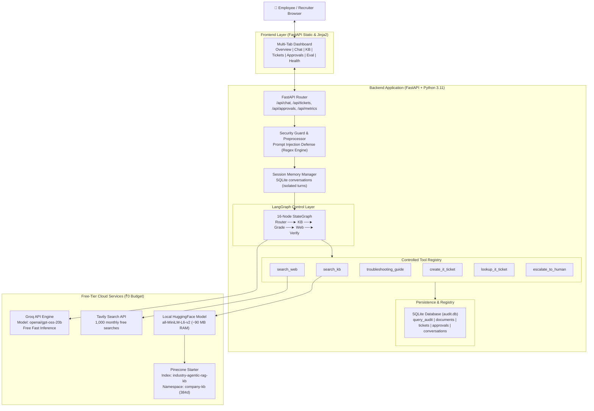
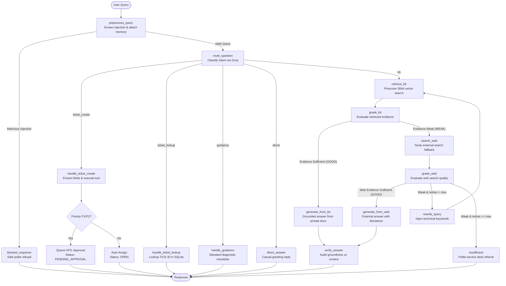
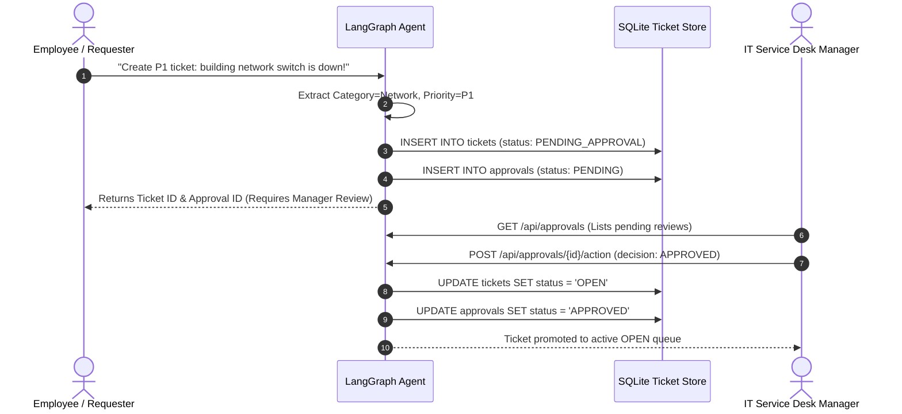
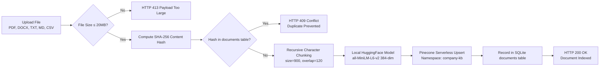

# System & Agentic Architecture Specification

This document details the complete production architecture of the **Enterprise IT Support Agentic RAG Copilot**, including the LangGraph directed acyclic graph (DAG), tool registry, human-in-the-loop approval workflow, and free-tier deployment architecture.

---

## 1. End-to-End System Architecture

---

## 2. LangGraph 16-Node Workflow DAG

---

## 3. Human-in-the-Loop (HITL) Safety Gate Flow

---

## 4. Document Ingestion & Deduplication Pipeline

